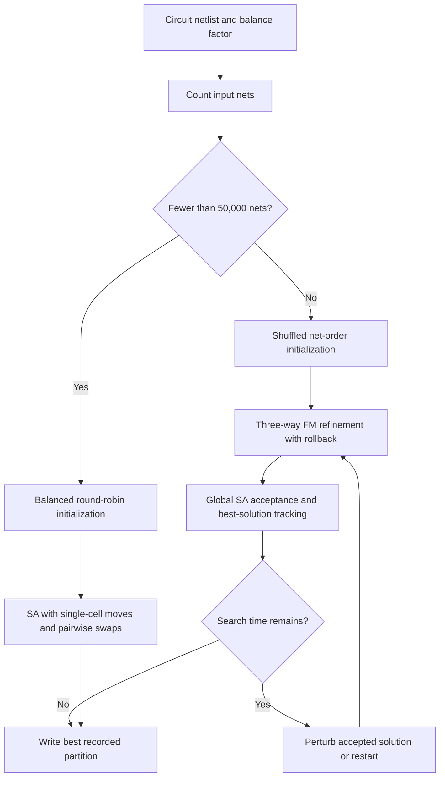

# Balanced 3-Way Circuit Partitioning

A VLSI circuit partitioning project that combines simulated annealing (SA) and Fiduccia–Mattheyses (FM) refinement to minimize cutsize under partition-balance constraints. The solver models a circuit as a hypergraph and assigns its cells to three groups, selecting a search strategy according to the number of nets in the input.

## My Contribution

I implemented the complete solver in [`main.cpp`](main.cpp), including input parsing, hypergraph data structures, both optimization strategies, and solution output. The implementation includes:

- **Size-based strategy selection:** a preliminary scan dispatches inputs with fewer than 50,000 nets to pure SA and larger inputs to FM refinement with a global SA acceptance rule.
- **Simulated annealing:** single-cell moves and pairwise swaps explore alternative partitions, with incremental cutsize evaluation over affected nets and probabilistic acceptance of worsening moves.
- **Three-way FM refinement:** gain buckets select feasible moves, cell locking prevents repeated moves within a pass, and rollback restores the best prefix of the move sequence.
- **Iterated local search:** perturbations, temperature reheating, and restarts explore new regions after local refinement or prolonged stagnation.
- **Incremental state maintenance:** cell-to-net adjacency lists and per-net partition counts support local cost and gain updates without recomputing the entire cutsize for every move.

The project applies hypergraph modeling, combinatorial optimization, and heuristic search to an electronic design automation (EDA) problem.

## Partitioning Pipeline



Cells are hypergraph vertices, and each net connects all cells that share it. A net contributes **one** to the cutsize if its cells occupy more than one partition, including when it spans all three groups.

For `N` cells and balance factor `r`, the target size of each partition is bounded by:

```text
ceil((1 - r) × N / 3) ≤ partition size ≤ floor((1 + r) × N / 3)
```

Single-cell moves check both the source and destination sizes. Pairwise swaps in the SA solver preserve partition sizes. Both strategies retain the best recorded solution for output.

## Build and Run

### Requirements

- GCC with C++14 support (`g++`)
- GNU Make
- Bash for `run.sh`
- A Linux environment compatible with the supplied `SolutionChecker` binary, such as Linux or WSL

Run the following commands from the project root.

### Build

```bash
make
```

The Makefile builds `Lab1` with `-O3`, `-Wall`, and `-std=c++14`. Use `make clean` before rebuilding an existing executable from another environment.

### Partition a circuit

```bash
./Lab1 case1.in case1.out
```

The command-line interface takes an input netlist and an output path:

```text
./Lab1 <input_file> <output_file>
```

### Validate the output

```bash
chmod +x SolutionChecker
./SolutionChecker case1.in case1.out
```

`SolutionChecker` is the course-provided validator. Use it to check the generated partition and its cutsize.

To rebuild, run, and validate all four included cases sequentially:

```bash
bash run.sh
```

The script reports execution time and writes `case1.out` through `case4.out`, overwriting any existing files with those names.

### Input and output formats

The input starts with the balance factor, followed by net definitions. Keep the terminating semicolon as a separate token to support both solver paths.

```text
0.01
NET n1 c1 c2 c3 ;
NET n2 c3 c4 ;
```

The output reports `Cutsize = <value>`, followed by `G1`, `G2`, and `G3`. Each group header contains its cell count, and the following line lists its cell names, ending with a semicolon.

## Evaluation

The objective is to reduce the number of cut nets while satisfying the balance constraints. Lower cutsize is better; runtime measures the search effort required to produce the partition.

All four benchmark cases use a balance factor of `0.01`.

| Benchmark | Cells | Nets | Strategy | Validation | Cutsize | Runtime (s) |
| --- | ---: | ---: | --- | --- | ---: | ---: |
| `case1.in` | 16,743 | 14,605 | SA | PASS | 980 | 3,400.057 |
| `case2.in` | 32,402 | 34,608 | SA | PASS | 2,354 | 3,400.098 |
| `case3.in` | 150,750 | 166,998 | FM + global SA | PASS | 13,775 | 3,400.800 |
| `case4.in` | 382,489 | 483,599 | FM + global SA | PASS | 35,789 | 3,401.418 |

All four benchmarks passed validation, including the largest input with **382,489 cells and 483,599 nets**.

## Implementation Notes

- **Preprocessing:** both solvers remove repeated cell entries within a net and exclude nets with fewer than two distinct cells from cutsize optimization. Strategy selection uses the original input net count before preprocessing.
- **SA schedule:** the smaller-input solver starts at temperature `10`, multiplies it by `0.9995` after each batch, and attempts `max(1000, 20 × N)` moves per temperature level. It stops when the temperature falls below `0.001` or its elapsed-time check is triggered.
- **FM search:** the larger-input solver initializes cells by shuffled net order, updates gains around affected nets, and rolls each pass back to its best recorded state. The outer search perturbs the accepted partition, applies SA acceptance, and restarts after more than 50 iterations without a new global best.
- **Runtime controls:** both solvers use a 3,400-second search threshold. SA checks time every 50,000 attempted iterations; the FM solver checks between outer search iterations. These checks allow runtime to exceed the threshold and do not impose a hard end-to-end deadline.
- **Reproducibility:** both solvers use random seed `1337`. Elapsed-time stopping can still change the amount of work completed and the final cutsize across machines.
- **Scope:** this is a heuristic solver for the supplied netlist format. It does not guarantee a globally optimal partition.

## Source Guide and Attribution

| File or component | Role and origin |
| --- | --- |
| [`main.cpp`](main.cpp) | My complete implementation of parsing, SA, three-way FM refinement, search control, and output generation |
| [`Makefile`](Makefile) | C++14 build configuration |
| [`run.sh`](run.sh) | Batch execution, timing, and validation for all four benchmarks |
| `SolutionChecker` | Course-provided solution validator |
| `case1.in`–`case4.in` | Benchmark netlists |

Developed for the Physical Design Automation course at National Yang Ming Chiao Tung University (NYCU).
